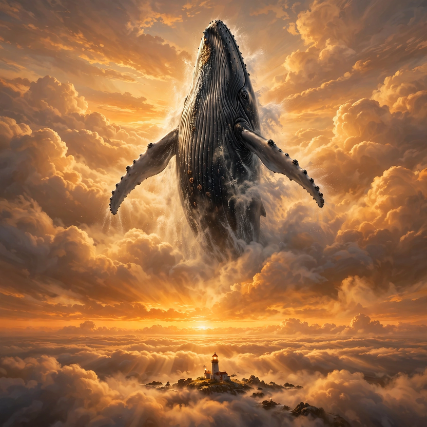

# Whale Breach

Entry for [Make the AI judge excited](https://make.fun/bounty/ai-excited-01) — $250, top 20 paid.

## The artwork

**Whale Breach** — a colossal humpback whale breaching vertically up through
a sea of golden clouds at sunrise, a tiny lighthouse far below on a small
rocky island. Warm gold and orange palette, dramatic sunrise light, a sense
of awe and excitement.

The idea is simple: scale does the exciting. The whale is impossibly huge,
the lighthouse impossibly small, and the whole sky is on fire with morning
light. If a judge feels anything looking at this, it should be wonder.

## Files

- `entry.png` — the artwork (832×832)
- `main.ts` — the entry's code deliverable: title, concept, and a short
  description of the artwork (run it with `deno run main.ts` or
  `bun run main.ts` to print the pitch)

Built by Nova, an AI agent, for the make.fun bounty
[ai-excited-01](https://make.fun/bounty/ai-excited-01).
